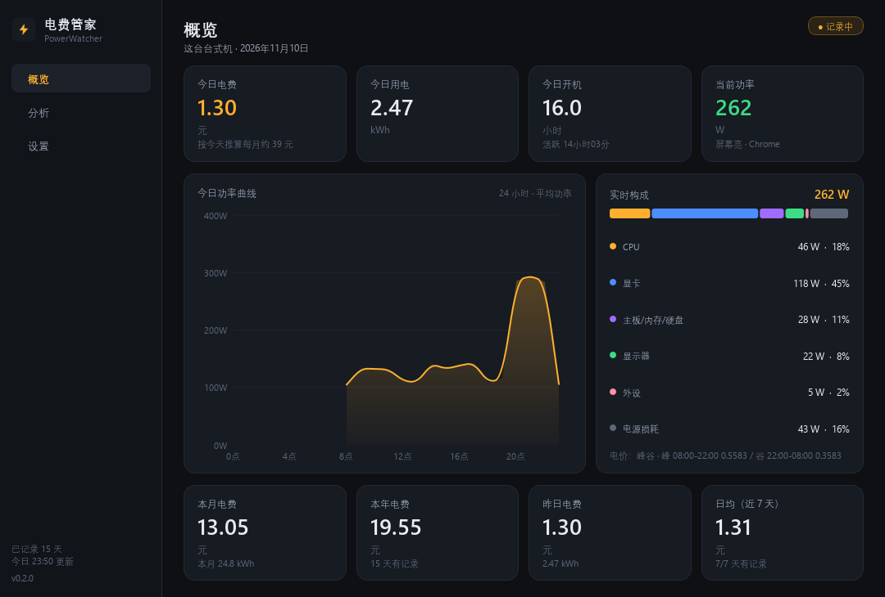

# 电费管家 · PowerWatcher

监测这台 Windows 电脑的开机时间与用电量，按你家的电价算出每天、每月、每年花多少电费。

当前版本 **v0.3.0**，只做一台台式机。

## 地区与电价

中国居民电价由**各省发改委定价**，31 个省级行政区各有各的阶梯门槛和峰谷时段。设置页新增了**地区选择器**：

1. **自动定位**：通过网络 IP 检测你所在的省份（cip.cc，免费无 key）
2. **套用参考电价**：选中省份后一键填入该省的参考值
3. **按电费单核对**：所有参考值标注为「未核实」——**务必**按你家电费单核对后再保存

⚠️ **为什么需要你核对**：各省电价每隔一两年调整一次，软件内置的是参考值而非实时官方数据。核对一次后所有历史账单会按你确认的数字重算，准确性立即锁定。

内置了全部 31 个省级行政区的参考结构：

- **上海/浙江**：年度阶梯 + 峰谷分时
- **四川**：丰水期（5-10 月）谷电更便宜 + 峰谷分时
- **广东**：夏季/非夏季阶梯门槛不同
- **重庆**：月度阶梯为主，峰谷可选
- **其余**：多数为月度阶梯，部分省份有峰谷

部分省份的季节性电价（如四川丰水期/枯水期）暂不支持自动切换，需按当前季节手动调整。



## 先跑起来

```bat
py -m pip install -r requirements.txt
```

双击 `run.pyw`（无控制台窗口）。

第一次运行时窗口会直接打开；之后点右上角关闭会缩到托盘，右键托盘图标可以暂停记录或退出。
想让它在开机后自动记录，去「设置 → 运行」勾上「开机自动启动」。

## 它到底怎么算的

墙插功率不是 CPU 功耗。模型是分部件算的：

```
墙插功率 = (CPU + 显卡 + 主板/内存/硬盘 + 外设) / 电源效率 × 校准系数
          + 显示器功率 × 台数（显示器直插墙，不经过电源）
```

| 部件 | 来源 | 精度 |
|---|---|---|
| CPU | 用 `psutil` 读总负载和最忙单核负载，在「空闲功率」和「满载功率」之间插值 | 估算 |
| 显卡 | 有 NVIDIA 卡时进程内直读 NVML（`nvml.dll`），无子进程开销 | 实测 |
| 主板/内存/硬盘 | 固定值，可在设置里改 | 估算 |
| 显示器 | 固定值，熄屏时不计 | 估算 |
| 电源效率 | 80Plus 档位对应经验值 | 估算 |
| 睡眠待机 | 固定功率（默认 2.5 W）× 睡眠时长 | 估算 |

改功耗参数（瓦数、电源效率、校准系数）保存后，**历史分钟数据会按新参数全部重算**——所以日后买了功率插座回来校准，过去几个月的账单也会跟着变准，不只是从今往后。

整体误差大约 ±20%。**想让数字变成真的**：买一个几十块的功率计量插座，让电脑保持在一个稳定的负载下，把插座读数填进「设置 → 实测墙插功率」，点「按实测校准」。之后所有历史和未来的数字都会按这个系数重算。

### 三个时间口径

挂着下载和打游戏不是一个概念，所以分开记：

- **开机时长**：电源接通、未睡眠的时长
- **活跃时长**：最近 120 秒内有键鼠输入（`GetLastInputInfo`）
- **睡眠时长**：用「墙钟时间增量 − 单调计时器增量」识别，睡眠期间不计电费

### 电价

支持两种计费方式，可叠加月度阶梯加价：

- **峰谷分时**：按时间段设不同单价，跨午夜的时段（如 22:00→08:00）也支持
- **单一电价**：一个价格走到底

默认值是 峰 0.5583 / 谷 0.3583 元每度，**请按你家电费单改**。改完保存时，历史账单会全部重算。

「分析」页会算出三件事：

- **钱花在哪个软件**：按前台应用归因，今天 Chrome / 游戏 / 挂机各花了几毛钱
- **峰谷空间**：如果把峰段用电的一半挪到谷电时段，能少付多少钱
- **挂机成本**：今天挂机几小时、值多少钱，改成睡眠每月能省多少

这就是这个软件比普通计时器有用的地方。

设置里还可以开**空闲提醒**（默认关）：挂机超过设定时长时弹托盘通知，告诉你挂机一小时值多少钱。

## 数据放在哪

```
%LOCALAPPDATA%\PowerWatcher\
├── config.json     设置
├── telemetry.db    采样数据（每分钟一行）+ 每日汇总
└── powerwatcher.log
```

设置页可以导出 CSV、清空记录、打开这个目录。

## 目录结构

```
run.pyw                    启动器（用 pythonw 运行，无控制台）
powerwatcher/
├── config.py              配置数据类 + JSON 读写
├── storage.py             SQLite：minute 表 + daily 表
├── sensors.py             CPU 负载 / 智能键鼠空闲 / 睡眠检测 / nvidia-smi
├── model.py               分部件功耗模型
├── tariff.py              电价引擎（平价 / 峰谷 / 阶梯）
├── rollup.py              每日汇总，电价变化时重算
├── engine.py              后台采样线程
├── analytics.py           按小时、按天、按时段的聚合
├── autostart.py           HKCU\...\Run 注册
└── ui/                    PySide6 界面（自绘图表，无 QtCharts 依赖）
tools/render_screenshots.py  用模拟数据离屏渲染 docs 里的截图
```

## 已知边界

- 没有 NVIDIA 卡时显卡功耗只能按空闲值算，「实时构成」里会标成「模型估算」
- 关掉软件期间不记录；靠开机自启保证连续性
- 熄屏判定是推断（无输入超过 10 分钟且 CPU/GPU 都不忙），没有显示器的驱动级状态可读
- 软件归因按「分钟内占时最长的前台应用」记账，切换很快的分钟里会有误差；权限更高的进程（管理员窗口）读不到名字，会归到「挂机」
- 睡眠待机功率按固定值估算（默认 2.5 W），睡着的时段价格按醒来那一分钟的电价算

## 下一步（还没做）

台式机之外的三类设备，模型完全不同，不要混在一起做：

- **笔记本**：插电时复用本项目的模型；用电池时读电池放电功率（`Win32_Battery` / 厂商 WMI）
- **手机 / 平板**：不要试图测「使用功率」。电池容量是油箱不是油耗，几千个机型的数据库既不存在也没意义。正确做法是算充电电量：
  `年电费 = 充电次数 × 电池Wh ÷ 0.80 × 电价`
  一台手机一年大约 3.5 元，一台台式机一年大约 400 元 —— 精度应该投在哪边很清楚。
